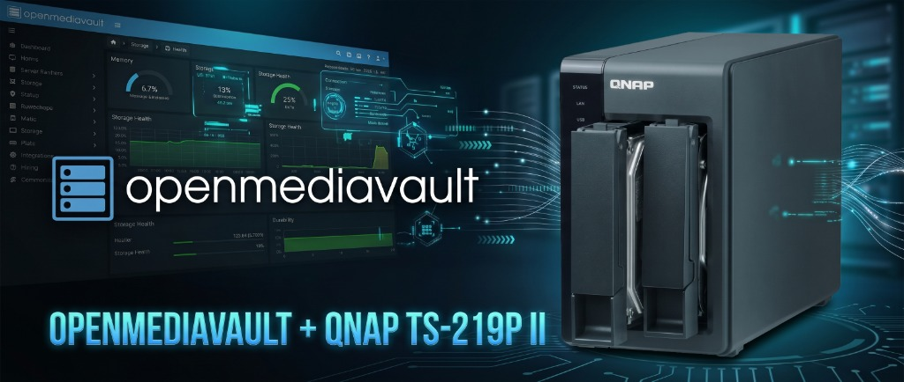
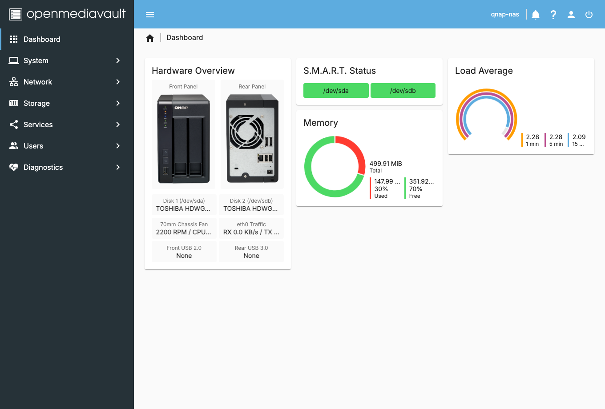
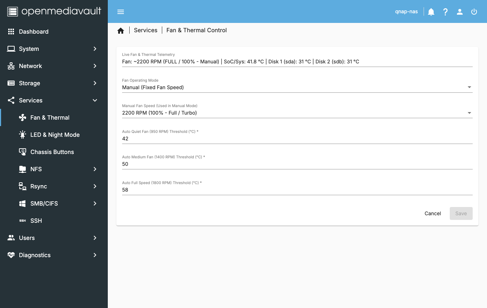
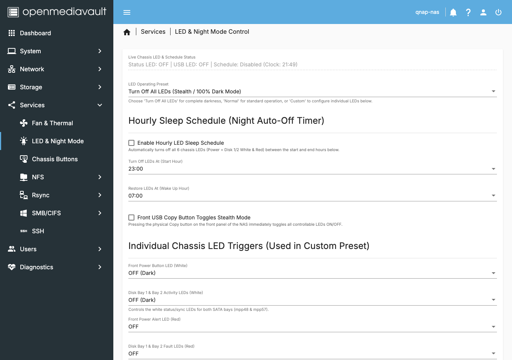
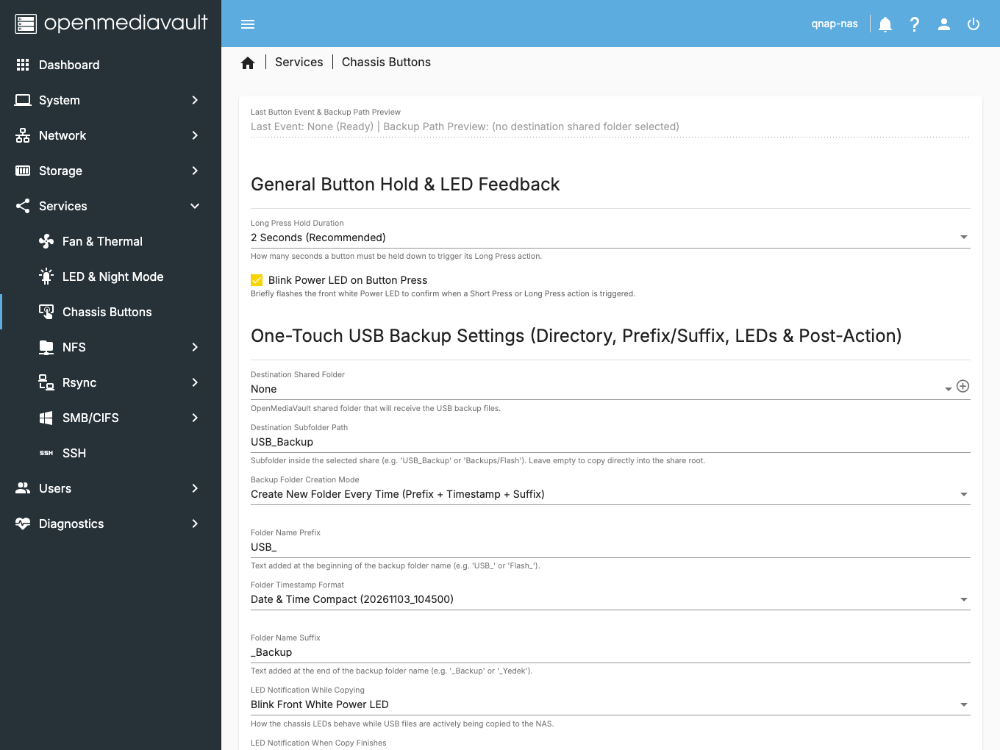
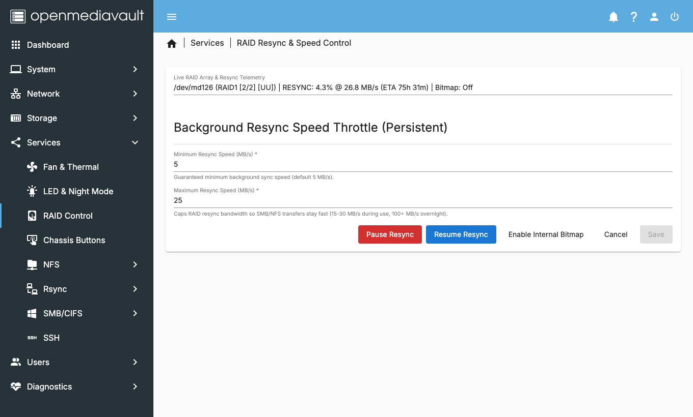

<p align="center">
  
</p>

# Debian 12 + OpenMediaVault 7 for the QNAP TS-219P II (Marvell Kirkwood 88F6282)

<p align="center">
  
  
  
  
  
</p>

Run a **current, maintained Debian 12 (Bookworm) with OpenMediaVault 7 (Sandworm)** on the discontinued **QNAP TS-219P II** — installed **from stock QTS over SSH without wiping your existing RAID 1 data volume**, keeping U-Boot (`mtd0`) completely untouched for safe TFTP recovery.

Includes native OMV 7 plugins tailored specifically for the QNAP TS-219P II hardware: **6-stage PIC16F fan curve & thermal control**, **chassis LED & night-mode schedule**, **front Power / One-Touch USB Copy / rear Reset buttons with automated USB backup**, and an **interactive Hardware Overview dashboard widget** (English + Turkish) mapping every physical port (2× HDD bays, 70mm fan, Front USB 2.0, 2× Rear USB 3.0, 2× Rear eSATA II, and Gigabit LAN).

> [!WARNING]
> This is a community project, not affiliated with or supported by QNAP or OpenMediaVault. It has been developed and verified on a live **QNAP TS-219P II** (Marvell Kirkwood 88F6282 @ 2.0 GHz, 2 × 8 TB Toshiba HDWG480 RAID 1). Always back up critical data before modifying SPI NOR flash partitions. The installer automatically creates a verified full SPI NOR flash backup (`mtd0`–`mtd5` + U-Boot env) before writing anything.

---

## Contents

- [Hardware](#hardware)
- [Why replace stock QNAP QTS?](#why-replace-stock-qnap-qts)
- [Performance & optimizations](#performance--optimizations)
- [What you get](#what-you-get)
- [How it boots (SPI NOR layout & loop-root)](#how-it-boots-spi-nor-layout--loop-root)
- [Installation](#installation)
- [After installation](#after-installation)
- [UART serial console & TFTP recovery](#uart-serial-console--tftp-recovery)
- [Plugins & Screenshots](#plugins--screenshots)
- [Building from source](#building-from-source)
- [Known limitations](#known-limitations)
- [Repository layout](#repository-layout)
- [Credits & License](#credits--license)

---

## Hardware

| Component | Details |
| :--- | :--- |
| Model | **QNAP TS-219P II** (`DB-88F6282A-BP LE TS-219P2+`) |
| SoC | Marvell **Kirkwood 88F6282 Rev A1**, 1 × Feroceon 88FR131 (ARMv5TE `armel`) @ **2.0 GHz**, 256 KB L2 |
| RAM | 512 MB DDR3 |
| Flash | 16 MB SPI NOR Flash (`spi0.0` / `m25p128`), U-Boot 1.1.4 Marvell 3.5.3 |
| Internal Storage | 2 × SATA II (3 Gb/s, `sata_mv`), hot-swap trays |
| External Storage | **2 × Rear eSATA II** (JMicron JMB363 PCIe `ahci`) |
| Network | 1 × Gigabit Ethernet (`mv643xx_eth`), original MAC preserved |
| USB | **1 × Front USB 2.0** (`orion-ehci`) + **2 × Rear USB 3.0** (Etron EJ168 PCIe `xhci_hcd`) |
| Microcontroller | **PIC16F** on `/dev/ttyS1` (19200 8N1) — 6-stage fan, Status/USB/Power LEDs, buzzer, 5-min boot watchdog |
| Buttons | Front **Power**, Front **One-Touch USB Copy** (`KEY_COPY`), Rear **Reset** pinhole (`KEY_RESTART`) |
| Other | I²C RTC (`rtc-s35390a`), Kirkwood SoC thermal sensor, Orion hardware watchdog, 2 × Marvell XOR engines |
| Stock OS | QNAP QTS 3.4 / 4.3 — Linux 2.6.33 / 3.4 (EOL, outdated SSL/SMB) |

Factory disk layout (GPT / RAID 1, `mdadm` metadata 1.0) — **kept 100% intact**:

| Partition | QTS Array | Size | Use in Debian + OMV 7 |
| :--- | :--- | :--- | :--- |
| `sdX1` | `md9` | 530 MB | Stock QTS root (untouched) |
| `sdX2` | `md2` | 530 MB | **RAID 1 Swap** (reused automatically by Debian) |
| `sdX3` | `md0` | Remainder | **Your Data Volume (ext4)** → mounted at `/media/internal_1` + holds `debian_omv.img` |
| `sdX4` | `md13` | 458 MB | Stock QTS ext (untouched) |

---

## Why replace stock QNAP QTS?

| | Stock QNAP QTS (EOL) | This project |
| :--- | :--- | :--- |
| Kernel | Linux 2.6.33 / 3.4 (EOL) | Debian 12 Linux **6.1 LTS** (`linux-image-marvell`) |
| Security updates | Discontinued | Debian 12 security & OMV 7 updates via `apt` |
| Web UI | Legacy QTS | **OpenMediaVault 7 (Sandworm)** |
| File sharing | Legacy SMB1/2 | **Samba 4.17 (SMB2/SMB3)**, **NFS v3/v4**, **WSDD** (Windows Discovery), SSH/SFTP |
| Idle RAM usage | ≈ 240–300 MB | **≈ 125 MB** with OMV 7 + hardware daemon running |
| USB 3.0 & eSATA | Yes | **Full support** (Etron xHCI USB 3.0 + JMicron AHCI eSATA + Front USB 2.0) |
| Fan control | Fixed firmware logic | **6-stage PIC16F** configurable thermal curve or manual speed from Web UI |
| LEDs & buttons | Fixed functions | Configurable **STATUS / USB / POWER** LEDs, night schedule & short/long press actions |
| Package ecosystem | Closed QPKG | Full Debian 12 `armel` archive |
| Recovery | QNAP Recovery | Untouched U-Boot (`mtd0`) + **TFTP RAM boot** + verified full SPI NOR backup |

---

## Performance & optimizations

The Marvell Kirkwood 88F6282 is a single-core 2.0 GHz ARMv5TE processor with 512 MB DDR3 RAM. This image includes targeted tuning to keep idle RAM around **~125 MB** and maximize Gigabit throughput:

- **PHP-FPM `ondemand` mode:** Workers spawn only when the OMV Web UI is open and exit after 10 s idle (`pm.process_idle_timeout = 10s`), saving ~60 MB RAM.
- **Heavy background daemons masked:** `monit`, `postfix`, `qcontrold` (replaced by our unified `qnap-ts219p-hwd`), `collectd`, `rrdcached`, and `systemd-networkd-wait-online` are disabled/masked so disks can spin down and CPU stays idle.
- **Volatile rate-limited journald:** `Storage=volatile` (16 MB cap) prevents constant log writes from waking spinning HDDs.
- **Samba ARMv5TE Gigabit tuning:** `server signing = disabled`, `smb encrypt = off`, `aio read/write size = 16384`, `use sendfile = yes`, `min receivefile size = 16384`, `TCP_NODELAY`.
- **Kernel-space NFS:** For maximum Gigabit transfer speeds on macOS/Linux, NFS v3/v4 bypasses userspace Samba CPU overhead.
- **Real-world benchmark (2 × 8 TB Toshiba HDWG480 RAID 1, 1000 Mbps Full Duplex):**
  - SMB Write (single-stream `dd`): **~31 MB/s** (~35–45 MB/s buffered Explorer/Finder)
  - SMB Cold Read (single-stream `dd`): **~41 MB/s** (~55–70 MB/s buffered Explorer/Finder)

---

## What you get

- **Debian 12 `armel` + OpenMediaVault 7** in a single loop-mounted ext4 image (`debian_omv.img`, auto-expanded online to **32 GB** on first boot) stored on your existing RAID 1 data volume (`/media/internal_1`).
- **Zero data loss:** Your existing folders (`Backup`, `Multimedia`, `Public`, etc.) stay right where they are on `/media/internal_1`.
- **Automatic RAID 1 swap** on QNAP's existing 530 MB swap array.
- **Clean PIC16F watchdog handling:** U-Boot arms a 5-minute hardware power-off watchdog (`uart1 0x68`) on every boot; our custom initramfs disarms it immediately via POSIX octal `0x67` (`\147`) on `/dev/ttyS1`, reinforced by `qnap-ts219p-hwd` and `qnap-boot-healthcheck.service`.

---

## How it boots (SPI NOR layout & loop-root)

Stock QNAP TS-219P II allocates only **2 MB** for `Kernel` (`mtd1`) and **9 MB** for `RootFS1` (`mtd2`), which is too small for a modern Debian 6.1 kernel + initramfs. Following the proven `qnap_mtd_resize` approach, the installer safely resizes the SPI NOR layout **without touching `mtd0` (U-Boot)**:

| Partition | Stock Layout | Resized Layout (Debian 12) | Notes |
| :--- | :--- | :--- | :--- |
| `mtd0` (`uboot`) | `512 KB @ 0x000000` | **`512 KB @ 0x000000` (UNTOUCHED)** | Factory U-Boot 1.1.4 (read-only) |
| `mtd4` (`U-Boot_Config`) | `256 KB @ 0x080000` | `256 KB @ 0x080000` | Updated `bootcmd` & `cmdlinepart.mtdparts` |
| `mtd5` (`NAS_Config`) | `1280 KB @ 0x0c0000` | `256 KB @ 0x0c0000` | Cleanly shrunk via `resize2fs` |
| `mtd1` (`Kernel`) | `2 MB @ 0x200000` | **`3 MB @ 0x100000`** | Debian 6.1 `uImage` + `kirkwood-ts219-6282.dtb` (~2.5 MB) |
| `mtd2` (`RootFS1`) | `9 MB @ 0x400000` | **`12 MB @ 0x400000`** | `xz --check=crc32` custom loop-root initramfs (~7.0 MB) |
| `mtd3` (`RootFS2`) | `3 MB @ 0xd00000` | Reclaimed into `mtd2` | Gives 12 MB headroom for future kernels |

At boot, U-Boot copies `uImage` (`mtd1`) to `0x800000` and `initrd` (`mtd2`) to `0xb00000`, then starts Linux 6.1. Our custom `/init`:
1. Disarms the QNAP PIC16F 5-minute boot watchdog (`0x67` on `/dev/ttyS1`).
2. Loads Kirkwood storage, RAID 1, Ethernet, USB 2.0/3.0, eSATA, SPI NOR, and RTC drivers.
3. Automatically locates the ext4 RAID 1 data array (`/dev/md*` > 5 GiB, immune to `udev` MD renumbering).
4. Mounts `/media/internal_1/debian_omv.img` on `/dev/loop0`, moves the data volume to `/media/internal_1`, and hands off to Debian 12 `systemd` via `run-init`.

---

## Installation

1. Download the release artifacts from **GitHub Releases** (or build them yourself via Docker):
   - `qnap-ts219p-omv7-rootfs-1.0.0.img.gz`
   - `uImage.mtd1`
   - `initrd.mtd2`
   - `install-from-qts.sh`
2. Copy them to `/share/MD0_DATA/omv-install/` on your QNAP running stock QTS via `scp`.
3. SSH into stock QTS (`admin`) and run the installer:
   ```bash
   cd /share/MD0_DATA/omv-install
   sh install-from-qts.sh
   ```
4. The installer will:
   - Prompt for your `root` / OMV `admin` password and target rootfs size (default `32 GB`).
   - Dump and MD5-verify all 6 original SPI NOR flash partitions (`mtd0`–`mtd5`) to `/share/MD0_DATA/qnap-mtd-backup/`.
   - Extract `debian_omv.img` to `/share/MD0_DATA/debian_omv.img`.
   - Flash the resized `mtd5`, `mtd1` (`uImage`), `mtd2` (`initrd`), and `mtd4` (`U-Boot_Config`) with 100% readback verification.
5. Reboot and wait ~60 seconds for first-boot provisioning (SSH host key generation, password setup, online ext4 expansion to 32 GB, and swap activation).

---

## After installation

- **OpenMediaVault 7 Web UI:** `http://<nas-ip>` or `http://qnap-nas.local`
  - Username: `admin` / Password: *(chosen during install)*
- **SSH:** `ssh root@<nas-ip>` or `ssh root@qnap-nas.local`
- **Your existing files:** Mounted at `/media/internal_1` — add them under **Storage → Shared Folders** and enable **SMB/CIFS** or **NFS**.
- **S.M.A.R.T. monitoring:** Enable under **Storage → S.M.A.R.T. → Settings** (recommended power mode: `Standby`) and monitor `/dev/sda` & `/dev/sdb`.
- **Safe shutdown:** Use OMV Web UI **Shutdown**, `poweroff` over SSH, or hold the front **Power** button for 2 seconds.

---

## UART serial console & TFTP recovery

See [docs/UART.md](docs/UART.md) for the **QNAP TS-219P II motherboard `CN1` UART pinout photo** (`1: GND, 2: RX, 3: empty, 4: TX` @ `115200 8N1`), Flipper Zero / 3.3 V USB-UART setup, and step-by-step **U-Boot TFTP boot & stock QTS restoration**.

---

## Plugins & Screenshots

All plugins are packaged in `openmediavault-qnap-ts219p` with full **English** and **Turkish** UI translations.

### 1. Interactive Hardware Overview (Dashboard Widget)
Real-time front & rear QNAP TS-219P II chassis view with hover tooltips for Drive Bays 1 & 2 (model, serial, S.M.A.R.T., temperature), 70mm Cooling Fan, Gigabit LAN (`eth0` live RX/TX), Front USB 2.0, Rear 2× USB 3.0, Rear 2× eSATA II, and System/LED status.

<p align="center">
  
</p>

### 2. Fan & Thermal Control (6-Stage PIC16F)
Configure automatic thermal thresholds using the Kirkwood SoC sensor, or pin the 70mm chassis fan to any of the 6 PIC16F hardware speeds (`Stop`, `Silence`, `Low`, `Medium`, `High`, `Full`).

<p align="center">
  
</p>

### 3. LED & Night Mode Control
Manage the PIC16F-controlled **STATUS**, **USB**, and **POWER** LEDs (Stealth / Dark Mode, Normal, Custom) plus an hourly automatic night-sleep schedule.

<p align="center">
  
</p>

### 4. Chassis Buttons & One-Touch USB Copy
Assign custom short-press and long-press actions to the **Front USB Copy** button, **Front Power** button, and **Rear Reset** pinhole, including automated One-Touch USB backup to any OMV shared folder with custom folder naming, LED/buzzer feedback, and safe auto-eject.

<p align="center">
  
</p>

### 5. RAID Resync & Speed Control (Service + Dashboard Widget)
Monitor live RAID 1 resync progress, speed, ETA, and write-intent bitmap status directly from the OMV Dashboard (`RAID Resync & Health` widget), throttle background resync bandwidth (`Min / Max MB/s`, persisted across reboots), pause/resume resync (`frozen` / `idle`), and enable the internal write-intent bitmap with one click.

<p align="center">
  
</p>

---

## Building from source

Everything builds cleanly inside Docker (Apple Silicon / x86_64 via QEMU `arm32v5`):

```bash
# 1. Build the two Debian packages (qnap-ts219p-boot & openmediavault-qnap-ts219p)
docker run --rm -v "$PWD":/repo debian:bookworm-slim bash /repo/tools/build-debs.sh

# 2. Build the complete Debian 12 armel + OMV 7 rootfs image + uImage.mtd1 + initrd.mtd2
docker run --rm --privileged -v "$PWD":/repo arm32v5/debian:bookworm-slim bash /repo/tools/build-rootfs-docker.sh
```

Build outputs are written to `dist/` (`qnap-ts219p-omv7-rootfs-1.0.0.img.gz`, `boot/uImage.mtd1`, `boot/initrd.mtd2`, and `.deb` packages).

---

## Known limitations

- **Fan RPM readout:** The TS-219P II has no I²C fan tachometer chip; the PIC16F drives the 70mm fan in 6 discrete hardware stages (`0` / `700` / `950` / `1400` / `1800` / `2200` RPM nominal).
- **Hardware-wired LEDs:** The orange `LAN` LED and green `HDD1`/`HDD2` activity LEDs are wired directly to the Marvell PHY and SATA controller and cannot be turned off in software (same as stock QTS). Only `STATUS`, `USB`, and `POWER` LEDs are PIC16F-controlled.
- **No CPU overclocking:** Marvell Kirkwood `88F6282` clock (`2.0 GHz`) is hardware-strapped via SAR resistors; `2.0 GHz` is already the maximum factory clock for the Kirkwood family.
- **No Docker on NAS:** Debian 12 `armel` (ARMv5TE) with 512 MB RAM is best suited for native OMV 7 file serving (SMB, NFS, SSH/SFTP, rsync, S.M.A.R.T.) rather than containers.

---

## Repository layout

```text
.
├── .github/
│   └── FUNDING.yml
├── assets/
│   ├── banner.jpg
│   ├── nas_front.png / nas_rear.png
│   └── plugin_*.png                  # Live OMV 7 plugin screenshots
├── docs/
│   ├── UART.md                       # CN1 pinout & U-Boot TFTP recovery guide
│   └── img/uart-header.jpg
├── installer/
│   └── install-from-qts.sh           # Automated backup, SPI resize & flash installer
├── packages/
│   ├── qnap-ts219p-boot/             # Custom loop-root initramfs, PIC watchdog & flasher
│   └── openmediavault-qnap-ts219p/   # Native OMV 7 hardware plugins & dashboard widget
├── tools/
│   ├── build-debs.sh                 # Builds both .deb packages
│   └── build-rootfs-docker.sh        # Builds Debian 12 armel + OMV 7 rootfs & boot images
├── CHANGELOG.md
├── LICENSE
└── README.md
```

---

## Credits & License

- Architecture and OMV 7 hardware plugin framework inspired by [laserbirdx/seagate-nas2bay-omv](https://github.com/laserbirdx/seagate-nas2bay-omv).
- SPI NOR flash partition resize technique based on Martin Michlmayr's [cyrius.com QNAP TS-219 Debian guide](https://www.cyrius.com/debian/kirkwood/qnap/ts-219/) and [amouiche/qnap_mtd_resize_for_bullseye](https://github.com/amouiche/qnap_mtd_resize_for_bullseye).
- Licensed under **GNU General Public License v3.0** — see [LICENSE](LICENSE).
