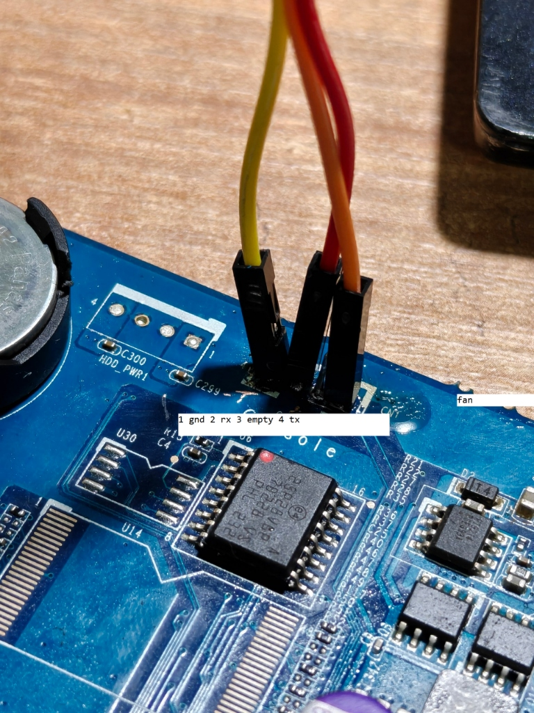

# UART Serial Console & U-Boot TFTP Recovery — QNAP TS-219P II

A 3.3 V USB-to-UART adapter (or a Flipper Zero in USB-UART Bridge mode) is **not required** for normal installation, but it provides full access to the U-Boot bootloader (`Marvell>>`) and Linux serial console (`ttyS0`) for debugging or recovering from a bad kernel/initramfs flash.

> [!CAUTION]
> **3.3 V TTL ONLY!** Never connect a 5 V USB-UART adapter or RS-232 cable to `CN1`, and **never** connect VCC if the NAS is powered by its own 12 V PSU. Only connect **GND**, **TX**, and **RX**.

---

## Motherboard Pinout (`CN1` — Console Header)

The 4-pin `CN1` console header is located on the mainboard edge right next to the 16-pin SPI NOR Flash chip (`25P128V6P` / `m25p128`) and the fan connector:

<p align="center">
  
</p>

| Pin | Label | Connection to USB-UART Adapter |
| :--- | :--- | :--- |
| **1** | **GND** | Adapter **GND** |
| **2** | **RX** (NAS RX) | Adapter **TX** |
| **3** | *Empty / NC* | Do not connect |
| **4** | **TX** (NAS TX) | Adapter **RX** |

### Serial Settings

- **Baud rate:** `115200`
- **Data bits / Parity / Stop:** `8N1`
- **Flow control:** None (disable hardware & software flow control)

```bash
# macOS / Linux (picocom or screen)
picocom -b 115200 --flow n /dev/cu.usbserial-*
# or with Flipper Zero USB-UART Bridge:
screen /dev/cu.usbmodemflip_* 115200
```

> [!TIP]
> If using a Flipper Zero USB-UART bridge to paste long U-Boot commands, pace characters slightly (~10 ms/char) so the bridge buffer does not drop characters.

---

## Interrupting U-Boot

1. Connect UART (`GND`, `TX↔RX`) and open your serial terminal at `115200 8N1`.
2. Power on the QNAP TS-219P II.
3. Press **Space** or **Enter** repeatedly during the `Hit any key to stop autoboot: 1` countdown to land at the `Marvell>>` prompt.

---

## Booting a Kernel / Initramfs Over TFTP (Recovery Without Reflashing)

Because `mtd0` (U-Boot) is never modified, you can always boot any kernel or initramfs directly into RAM over Gigabit Ethernet (`egiga0`):

1. Place `uImage.mtd1` and/or `initrd.mtd2` in your host's TFTP server directory (e.g., `/private/tftpboot` on macOS or `/srv/tftp` on Linux).
2. Connect the NAS directly (or via switch) to your TFTP host and run in U-Boot:

```text
setenv ipaddr 192.168.1.50
setenv serverip 192.168.1.10
setenv netmask 255.255.255.0
ping 192.168.1.10

# Load working Debian 6.1 kernel from SPI flash (or use: tftpboot 0x800000 uImage.mtd1)
cp.l 0xf8100000 0x800000 0xc0000

# Load initramfs over TFTP into RAM at 0xb00000
tftpboot 0xb00000 initrd.mtd2

# Disarm PIC 5-min watchdog (0x67) and boot Linux
uart1 0x67; bootm 0x800000
```

Once Debian boots, you can permanently re-flash `/dev/mtd1` (Kernel) or `/dev/mtd2` (RootFS1/initrd) using `flashcp -v`:

```bash
flashcp -v /path/to/initrd.mtd2 /dev/mtd2
```

---

## Restoring Stock QNAP QTS Firmware

Your original SPI NOR flash dump (`mtd0`–`mtd5` + `uboot_config.backup.txt`) is saved automatically on your data volume at `/media/internal_1/qnap-mtd-backup/` (and should also be copied off the NAS before installing).

To restore stock QTS from Debian (or via U-Boot TFTP):
1. Restore original `mtd4` (`U-Boot_Config`), `mtd5` (`NAS_Config`), `mtd1` (`Kernel`), `mtd2` (`RootFS1`), and `mtd3` (`RootFS2`) from your verified backup.
2. Reboot — the NAS boots directly back into factory QTS with your RAID 1 data intact.
